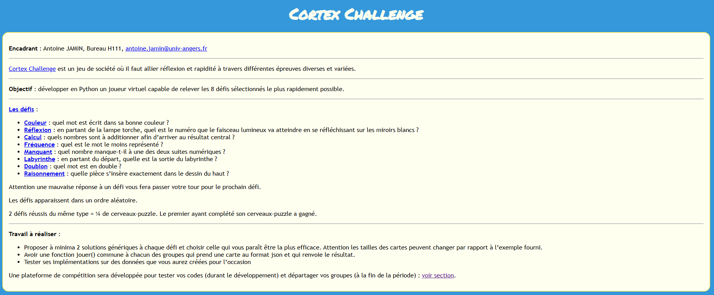
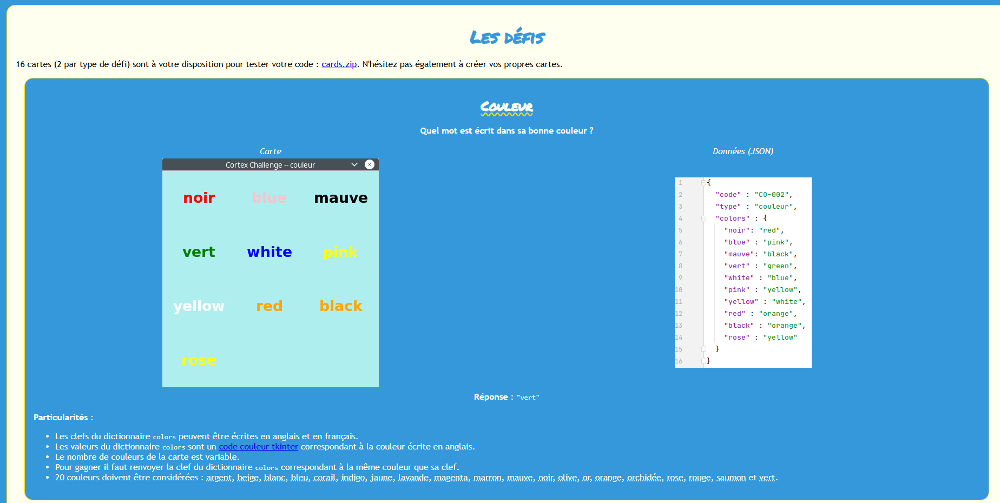
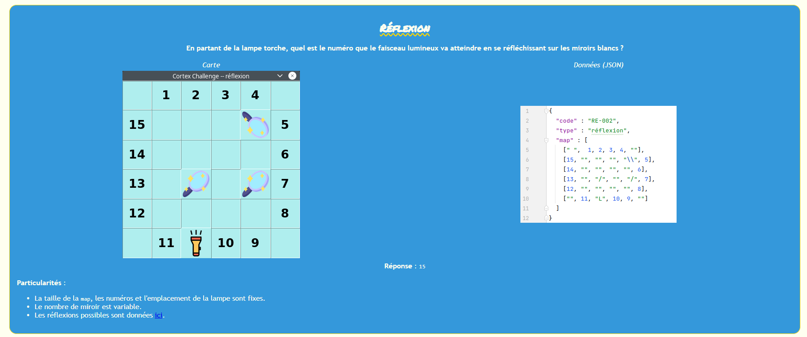
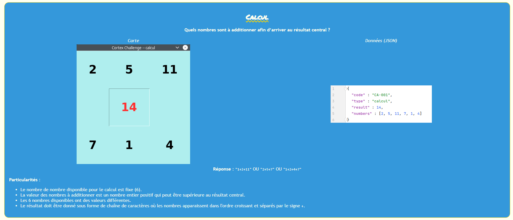
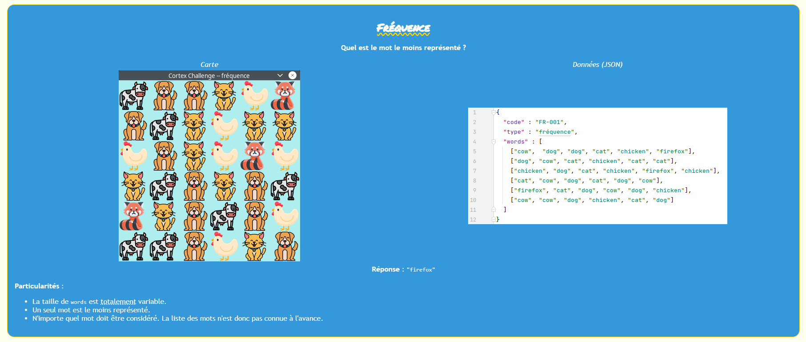
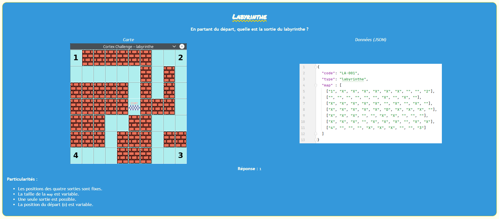
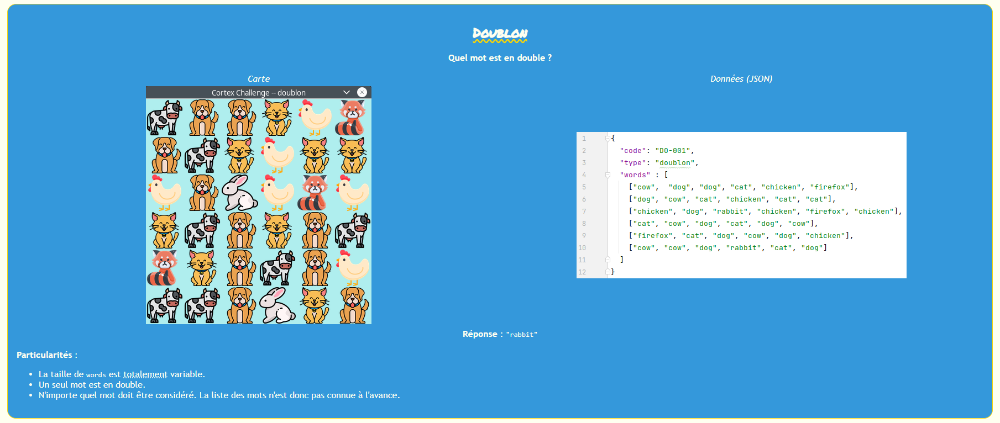
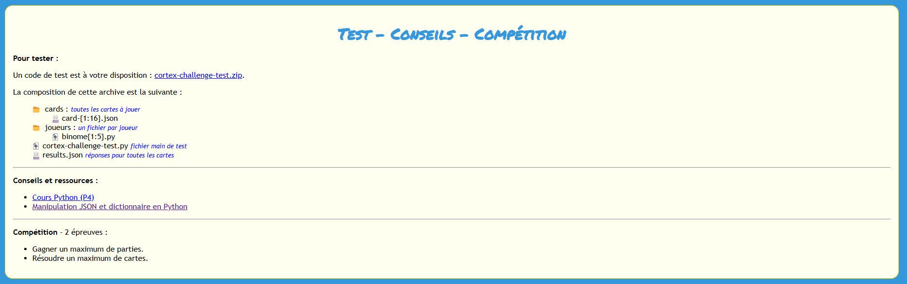

# 🧠 Projet Cortex Challenge - MI1A

> **Projet de programmation Python** > **Encadrants :** Antoine JAMIN, Paul AUBRUN & Kevin PLECIS
> **Auteurs :** Kevin PLECIS & Paul AUBRUN (L1 MI1A - Université d'Angers)

---

## 📝 Présentation du projet
Le **Cortex Challenge** est un jeu de société où il faut allier réflexion et rapidité à travers différentes épreuves. L'objectif est de développer en Python un **joueur virtuel** capable de relever 8 défis spécifiques le plus rapidement possible en analysant des données au format JSON.

---

## 🎮 Les Défis à relever
Chaque défi possède ses propres règles de résolution basées sur des structures de données précises.

### 🧩 Aperçu des épreuves
| Défi | Description visuelle | Logique métier |
| :--- | :---: | :--- |
| **Couleur** |  | Identifier le mot écrit dans sa propre couleur via un dictionnaire JSON. |
| **Réflexion** |  | Calculer la trajectoire d'un faisceau lumineux se réfléchissant sur des miroirs. |
| **Calcul** |  | Trouver la combinaison de nombres dont la somme égale le résultat central. |
| **Fréquence** |  | Déterminer quel élément est le moins représenté dans une matrice variable. |
| **Labyrinthe** |  | Trouver la sortie (1, 2, 3 ou 4) à partir d'un point de départ "D". |
| **Doublon** |  | Identifier l'unique mot présent deux fois dans la liste. |

---

## 🛠️ Organisation & Collaboration
Pour ce projet réalisé en binôme, nous avons mis en place une méthodologie de travail rigoureuse pour pallier la distance :

* **Outils de développement :** Utilisation intensive de **Visual Studio Code** pour ses fonctionnalités de débogage et de coloration syntaxique.
* **Gestion de version :** GitHub a servi de plateforme centrale pour partager le code, effectuer des révisions mutuelles et intégrer les changements via des *Pull Requests*.
* **Répartition des tâches :** Division du projet en parties équitables pour permettre un développement indépendant et simultané.
* **Communication :** Échanges constants via messagerie pour synchroniser nos avancées et résoudre les conflits de code.

---

## 🚀 Test et Compétition
Un environnement de test est disponible pour évaluer les performances du joueur virtuel :

1.  **Données :** Les cartes de test sont stockées dans le dossier `/cards` au format `.json`.
2.  **Exécution :** Le script `cortex-challenge-test.py` permet de lancer la simulation.
3.  **Objectif :** Résoudre un maximum de cartes et gagner le plus de parties lors de la plateforme de compétition finale.

---

### 📚 Ressources complémentaires
* Manipulation des dictionnaires et fichiers JSON en Python.
* Documentation des modules utilisés (Tkinter pour les codes couleurs).